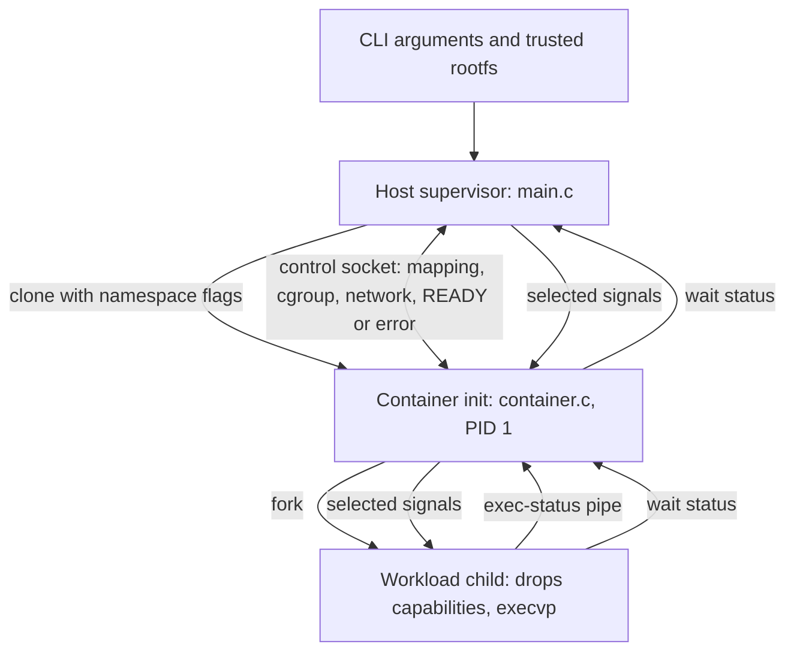

# Architecture and file map

Source: all 42 tracked files at
[`9ad1038`](https://github.com/AffableAWE/husk/tree/9ad10389375dbe55d6982e1d00211473ac8196c8).
The eight files under `src/` implement the runtime. The 30 files under `tests/`
build fixtures, launch suites, probe behavior, or measure performance. Four
other files cover the README, build, CI, and ignore rules.

## 1. What runs where?

The parent stays outside the new namespaces. The init sees itself as PID 1;
the parent sees the same process using its host-visible PID. The workload is
normally PID 2 inside. All processes share the Linux kernel. Optional rootless
mode changes the user namespace and ID mapping; it does not start a VM.

## 2. One launch, in execution order

1. **Parse and validate.** `main()` reads options, canonicalizes the rootfs and
   cgroup parent paths, validates the hostname and numeric values, and checks
   mode selection. It defers executable lookup until after the root switch.
2. **Prepare supervision.** The parent normalizes `SIGCHLD`, closes inherited
   descriptors above stdio, blocks the selected signals, opens `signalfd`, and
   creates an `AF_UNIX/SOCK_SEQPACKET` control socketpair with close-on-exec.
   It allocates a 1 MiB stack for the child using `mmap`.
3. **Acquire optional host resources.** Before `clone`, create/configure the
   unique child cgroup and verify its limits. Validate bridge configuration and
   acquire the address lease when requested.
4. **Create namespaces.** `clone(husk_child_main, ...)` starts the init with
   mount, PID, UTS, IPC, and network namespace flags. Rootless adds
   `CLONE_NEWUSER`. No `CLONE_VM` is used; the parent's later stack unmap does
   not remove the child's mapping.
5. **Protect the parent/child relationship.** The init closes the parent end of
   the socket and its inherited lease descriptor. It installs signal handlers,
   sets `PR_SET_PDEATHSIG=SIGKILL`, and peeks at the control socket to detect a
   parent that already died before that setting took effect.
6. **Map IDs, if rootless.** The init requests mapping and waits. The parent
   writes `uid_map`, `setgroups=deny`, and `gid_map`, then acknowledges. The
   init verifies that its UID/GID values are now zero inside.
7. **Join the cgroup, if enabled.** The init requests placement. The parent
   moves it into the prepared cgroup and verifies membership. After the
   acknowledgement, the init calls `unshare(CLONE_NEWCGROUP)` so its cgroup
   namespace root is the intended container cgroup.
8. **Connect the network, if enabled.** The init requests the veth. The parent
   creates it, connects the host endpoint to the existing bridge, and moves
   the peer into the init's network namespace. The init then configures its
   endpoint, loopback, address, and default route.
9. **Switch the filesystem view.** The init sets the hostname, makes mount
   propagation recursively private, bind-mounts the rootfs onto itself,
   switches roots using `pivot_root`, detaches the old root, and mounts procfs.
   In rootless mode procfs is mounted before the pivot; privileged mode mounts
   it afterwards. It verifies cgroup namespace presentation if enabled.
10. **Install restrictions.** The init applies/reads back rlimits, locks
    securebits, reduces capabilities, sets `no_new_privs`, and installs
    seccomp. Namespace/mount setup must finish before those operations become
    restricted.
11. **Start the workload.** The init opens an `O_CLOEXEC` status pipe and forks.
    The workload resets signal state, sets PATH/HOSTNAME and a HOME default,
    marks extra FDs close-on-exec, drops the remaining capabilities, and calls
    `execvp` inside the new root. Exec failure produces a report on the pipe.
12. **Confirm launch.** On the normal path, the init receives EOF because the
    pipe writer closed on successful exec. It removes its temporary
    `CAP_SETPCAP`, sends `READY`, and keeps waiting/reaping. This confirms the
    launch protocol, not application health or service readiness.
13. **Supervise and finish.** The parent forwards selected signals via the
    init. The init forwards them to the main workload, reaps adopted children,
    and kills remaining namespace processes once the main workload exits.
    The parent collects init status, removes its cgroup and networking
    resources, and returns the resulting exit code.

Read [main.c](https://github.com/AffableAWE/husk/blob/9ad10389375dbe55d6982e1d00211473ac8196c8/src/main.c)
and [container.c](https://github.com/AffableAWE/husk/blob/9ad10389375dbe55d6982e1d00211473ac8196c8/src/container.c)
side by side for this sequence.

## 3. Runtime files: what each one owns

| File | Responsibility | Functions/types to find first |
| --- | --- | --- |
| `src/main.c` | CLI validation, host-side resource acquisition, `clone`, handshakes, signal supervision, final cleanup | `main`, `parse_uint`, `await_start`, `supervise`, `status_to_exit` |
| `src/container.c` | PID 1 implementation, root switch, workload execution, exec diagnostics, signal forwarding, child reaping | `husk_child_main`, `setup_mounts`, `run_workload`, `wait_for_workload`, `format_exec_error` |
| `src/husk.h` | Shared module contract: config, protocol messages, timeouts, statuses, declarations, test-hook declarations | `husk_config`, `husk_msg`, `husk_msg_type`, `HUSK_*` constants |
| `src/userns.c` | Rootless mapping protocol, one-write map updates, bounded waits, kill/reap on failure | `husk_userns_parent_map`, `husk_userns_child_wait`, `write_map_file`, `recv_bounded` |
| `src/cgroup.c` | Controller delegation checks, unique cgroup creation, limit readback, init placement, namespace presentation, stale recovery | `husk_cgroup_create`, `configure_limits`, `move_child`, `recover_stale_cgroups`, `husk_cgroup_parent_handshake` |
| `src/security.c` | Rlimits, capability transition, securebits, `no_new_privs`, architecture-specific seccomp | `husk_security_apply_rlimits`, `husk_security_prepare_init`, `husk_security_workload_drop`, `husk_security_init_finalize`, `install_seccomp` |
| `src/network.c` | IPv4 validation, address leases, rtnetlink veth/link/address/route operations, bridge handshake, cleanup | `husk_network_validate`, `husk_network_lease_acquire`, `husk_network_parent_handshake`, `husk_network_configure_child`, `nl_talk` |
| `src/util.c` | Fixed-size control message send/receive, descriptor cleanup/fallback, optional test/performance hooks | `husk_send_msg`, `husk_recv_msg`, `husk_close_fds_from`, `husk_perf_mark` |

Module permalinks: [header](https://github.com/AffableAWE/husk/blob/9ad10389375dbe55d6982e1d00211473ac8196c8/src/husk.h),
[user namespace](https://github.com/AffableAWE/husk/blob/9ad10389375dbe55d6982e1d00211473ac8196c8/src/userns.c),
[cgroup](https://github.com/AffableAWE/husk/blob/9ad10389375dbe55d6982e1d00211473ac8196c8/src/cgroup.c),
[security](https://github.com/AffableAWE/husk/blob/9ad10389375dbe55d6982e1d00211473ac8196c8/src/security.c),
[network](https://github.com/AffableAWE/husk/blob/9ad10389375dbe55d6982e1d00211473ac8196c8/src/network.c),
[utilities](https://github.com/AffableAWE/husk/blob/9ad10389375dbe55d6982e1d00211473ac8196c8/src/util.c).

## 4. Build and repository files

| File | What it does |
| --- | --- |
| `README.md` | Public entry point: purpose, installation, examples, documentation links |
| `Makefile` | Compiles seven `.c` translation units into `husk`; exposes `all`, `rootfs`, `check`, `clean`; supports `CC` and `WERROR=1` |
| `.github/workflows/ci.yml` | Runs on push, PR, or manual dispatch; Ubuntu GCC/Clang matrix; strict build, rootfs, privileged smoke, cppcheck |
| `.gitignore` | Ignores generated binary, object files, `build/`, private notes, caches, and most Markdown; this documentation change adds `docs/*.md` as an exception |

The version constant lives in the header, not a package manifest. There is no
application framework, database, frontend, package manager, or external
container library in the runtime build. Shell and Python support the tooling.
The reviewed tree has no `LICENSE` file; do not invent one during a README edit.

## 5. Every test and helper file

The “stage” numbers name feature groups, not different runtimes. These files
test the same code under different environments.

| File | Purpose |
| --- | --- |
| `tests/Dockerfile.dev` | Debian development image with compilers, static BusyBox, system tools, iproute2, and cppcheck |
| `tests/make-rootfs.sh` | Creates the BusyBox rootfs, applet symlinks, minimal passwd/group files, and writable temporary directory |
| `tests/smoke.sh` | Privileged integration checks: launch, isolation, executable resolution, status/signal/lifecycle behavior, and harness ownership controls |
| `tests/rootless.sh` | Ordinary-user integration checks: ID mapping, isolation, command execution, inherited group behavior, mapping failures/deaths/timeouts, cleanup |
| `tests/rootless-docker.sh` | Prepares an ordinary user and owned rootfs inside the test container, then runs the rootless suite |
| `tests/stage34.sh` | Cgroup/rlimit enforcement and security checks, including capability sets, seccomp, thread compatibility, concurrent cgroups, and failure cleanup |
| `tests/stage34-docker.sh` | Prepares delegated cgroup subtrees and runs Stage 3/4 in privileged and rootless modes |
| `tests/stage5.sh` | Bridge configuration, TCP exchange, lease conflict/stale recovery, and network cleanup checks |
| `tests/stage5-docker.sh` | Creates the test bridge/lease directory, runs Stage 5, and checks rootless bridge rejection |
| `tests/stage6.sh` | Injected setup failures, parent-death recovery, concurrent healthy-run protection, and repeated-launch cleanup campaign |
| `tests/stage6-docker.sh` | Builds the test-hook binary and ownership helper, prepares networking/cgroups, and runs Stage 6 in both modes |
| `tests/exec_probe.c` | Minimal executable used to verify absolute-symlink and PATH lookup semantics |
| `tests/orphan_probe.c` | Creates an orphaned grandchild and checks whether PID 1 reaped it |
| `tests/sigchld_launcher.c` | Launches Husk with inherited `SIGCHLD=SIG_IGN` to test disposition normalization |
| `tests/deny_userns_wrapper.c` | Installs a test-only filter denying user-namespace creation so the failure path can be tested without changing host policy |
| `tests/no_proc_rootless_wrapper.c` | Hides procfs within its own namespaces to trigger missing parent-side mapping files |
| `tests/owned_run.c` | Owns a dedicated session/process group, records identity/status/leftovers, and delays emergency cleanup until after observation |
| `tests/leaky_helper.c` | Deliberately leaves a test child alive; negative control proving the harness can detect a leak before cleaning it |
| `tests/status_probe.c` | Reports workload/init credentials, capability sets, `NoNewPrivs`, seccomp state, and cgroup/mount information |
| `tests/seccomp_probe.c` | Attempts forbidden tracing and an ordinary file operation to check denial and continued useful execution |
| `tests/thread_probe.c` | Exercises pthread create/join and fork/wait under the security policy |
| `tests/rlimit_probe.c` | Reads soft/hard limits, opens descriptors to the limit, and attempts a size-limited file write |
| `tests/mem_probe.c` | Allocates and touches pages so the memory controller accounts actual use |
| `tests/pids_probe.c` | Forks multiple children to expose the cgroup task limit |
| `tests/cpu_probe.c` | Runs CPU work for a timed interval so throttling can be observed |
| `tests/net_probe.c` | Tiny TCP client/server checking communication across the bridge |
| `tests/perf-docker.sh` | Sets up test environments and records repeated privileged/rootless launch measurements and metadata |
| `tests/perf_runner.c` | Repeatedly forks/execs an instrumented runtime and writes CSV timestamps, return codes, and phase values |
| `tests/perf_stats.py` | Reads CSVs and reports failure count, median, p95, p99, minimum, and maximum |
| `tests/tap-adapter.sh` | Converts suite `ok`/`FAIL`/`skip` lines into Test Anything Protocol output |

Build output such as `build/rootfs`, the `husk` executable, object files,
test-specific copies, and evidence CSVs is generated. It is not additional
handwritten runtime source.

## 6. Invariants that explain the design

| Required ordering or rule | Why it matters |
| --- | --- |
| Install rootless ID maps before setup proceeds | Setup must use mapped credentials; the child cannot guess when the parent's writes finished |
| Configure cgroup and move init before it forks workload | Descendants inherit membership; moving only init after children already exist would leave those children outside |
| Join cgroup before creating cgroup namespace | Namespace root should represent the container cgroup |
| Make mount propagation private before bind/pivot | Mount operations must not propagate into shared host mount topology |
| Finish mount/network setup before dropping setup privileges and installing seccomp | Later policy intentionally denies operations needed during setup |
| Keep temporary `CAP_SETPCAP` until child drops its bounding set | The child must be able to perform that final capability transition |
| Keep the exec-status writer open until exec | Init needs to distinguish an exec failure report from the ordinary close-on-exec path |
| Close unused socket/pipe endpoints | A stray writer/reference can prevent EOF and make the handshake hang |
| Observe runtime leftovers before harness cleanup | Test cleanup must not hide runtime leaks |

## 7. Ownership and cleanup

| Resource | Owner / lifetime | Cleanup path |
| --- | --- | --- |
| Host-side signal FD and clone-stack mapping | Parent | Close FD; unmap parent's stack mapping after clone |
| Control socket endpoints | Parent/init | Each closes unused endpoints; close remaining control FDs after setup |
| Workload exec-status pipe | Init/workload child | Workload writer closes on exec or process exit; init reads and closes |
| Mounts and namespaces | Kernel objects referenced by processes/FDs/mounts | Released as references disappear; init death terminates the PID-namespace workload population |
| Cgroup directory | Parent under explicit delegated subtree | Remove after normal completion/rollback; recover recognized empty owner-dead cgroups on a later run |
| Veth pair | Parent-created host endpoint plus moved peer | Explicit normal deletion; namespace teardown also affects its peer |
| Address lease | Parent holds file lock and descriptor | Unlink/close normally; inspect dead-owner metadata when acquiring a stale lease |
| Rootfs files and possible new `/proc` directory | Supplied directory | Persistent; workload writes are not rolled back |
| Long-lived test invocation | `owned_run` test supervisor | Observe status/leftovers, wait for release, then clean only its owned group |

External namespace references can extend namespace lifetimes. `SIGKILL` cannot
run user-space cleanup. Recovery is deliberately narrow, not a complete
persistent runtime-state system.

## 8. Three failure traces to practice

**Rootless mapping denied:** clone or mapping write fails → diagnostic on the
relevant side → kill/reap init when it exists → parent releases acquired
resources → exit 125. The workload should never run.

**Executable missing:** namespace/filesystem/security setup succeeds → workload
`execvp` returns `ENOENT` → report through exec pipe → init sends `EXEC_ERROR`
with status 127 → parent prints diagnostic and cleans up. A missing loader can
follow the same path even if the executable file exists.

**Normal main workload exit with background children:** init records the main
workload status → kills remaining visible namespace processes → reaps → exits
with the main workload's status → parent reaps init and releases host resources.

## 9. Best reading order

`husk.h` → `main.c` control flow → `container.c` → `util.c` → `userns.c` →
`cgroup.c` → `security.c` → `network.c` → probes → integration suites →
performance tooling. Return to `main.c` after each optional module to see how
it participates in the launch sequence.
